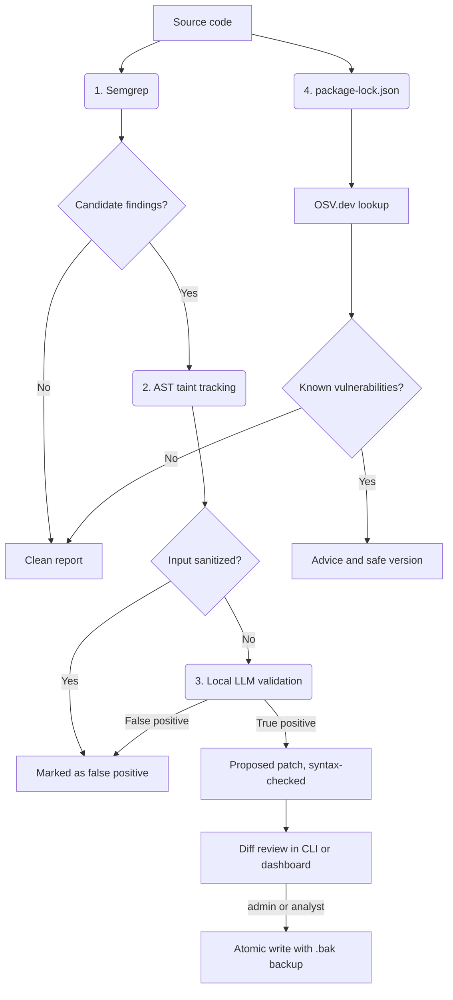

# CypherGuard AI — Local-First SAST + SCA for JavaScript/Node.js

[](https://vrsebeatriz.github.io/CypherGuard-IA)


CypherGuard AI is a security analysis tool for JavaScript and Node.js code. It runs Semgrep, checks each finding with AST taint tracking, and asks a **local LLM (Ollama)** to separate real vulnerabilities from false positives and to propose a patch. It also audits npm dependencies against OSV.dev.

Source code is analyzed on your machine and is never sent to a cloud AI provider. The only outbound requests are Semgrep downloading its rule packs and the dependency lookup on OSV.dev, which sends package names and versions.

---

## How it works

Traditional SAST tools report many false positives. CypherGuard AI filters them in layers:

1. **Semgrep scan.** Finds candidate issues with the `p/javascript`, `p/typescript`, `p/nodejs` and `p/security-audit` rule packs.
2. **AST taint tracking (Acorn).** Follows user-controlled input (`req.*`) and checks whether the identifier passes through a sanitizer before reaching the sink.
3. **LLM validation and patching (Ollama).** A local model judges each remaining finding as true or false positive and proposes a fix. The answer is validated against a Zod schema.
4. **Dependency audit (OSV.dev).** Resolves `package-lock.json`, including transitive dependencies, and looks up known vulnerabilities.

A Shannon entropy check flags high-entropy strings, such as hardcoded keys. The threshold is set in `cypherguard.yml`.



---

## Features

### Patching with safety checks
- **Syntax validation.** The patched file is parsed with Acorn before anything is written.
- **Atomic writes.** The patch goes to a temporary file that is then renamed, so a failed write cannot corrupt the original.
- **Backups.** A `.bak` copy of the file is created before it is changed.
- **Diff review.** The CLI and the dashboard show the diff before a patch is applied. The CLI requires a clean git working tree.

### Access control
- **Three roles.** `admin` (everything, including users and configuration), `analyst` (run scans and apply patches) and `auditor` (read-only access to reports and the audit log).
- **Access requests.** A new user can request access; an admin approves or rejects it. Admins can also change roles, reset passwords and delete users.
- **Password storage.** PBKDF2-SHA512 with a random salt per user and 100,000 iterations, compared in constant time.
- **Sessions.** Random 32-byte tokens that expire after 24 hours.

### Audit log and history
- **Audit log.** Logins, scans, applied patches, configuration changes and user management are recorded in `data/audit_log.json` with user, role, timestamp, action and IP address. Admins and auditors can read it.
- **Scan history.** Each scan is saved in `data/` and can be reopened or deleted. `/api/history/stats` returns totals, severity distribution and patch rate.

### Hardening of the tool itself
- **Path guard.** File paths are resolved with `realpath` and must stay inside the project root, which blocks directory traversal and symlink escapes.
- **No shell.** Semgrep and git are called with `execFile`, so a path is never interpreted as a command.
- **Prompt injection.** Code sent to the model is wrapped in explicit delimiters, and the model output must match a strict schema.
- **Rate limiting.** 60 requests per minute per IP on the API.

### SARIF output
- Results can be exported as SARIF 2.1.0, from the CLI (`--sarif`) or the API (`/api/export/sarif`), for tools that read the format, such as GitHub Code Scanning.

---

## Technology stack

| Area | Technologies |
| :--- | :--- |
| **Language and runtime** | TypeScript 5.6, Node.js 18+ |
| **Static analysis** | Semgrep, Acorn 8, acorn-walk |
| **AI** | Ollama through LangChain (`@langchain/ollama`); default model `qwen2.5:7b` |
| **Dependency analysis** | OSV.dev API, semver |
| **API and CLI** | Express 5, Commander |
| **Validation and security** | Zod, Node.js `crypto` (PBKDF2), `realpath` path guard |
| **Dashboard** | HTML, CSS and JavaScript without a framework |
| **Tests** | Jest and Supertest: 125 tests in 13 suites |
| **Output** | SARIF 2.1.0 |

---

## REST API

| Method | Endpoint | Access | Description |
| :--- | :--- | :--- | :--- |
| `POST` | `/api/auth/login` | Public | Logs in and returns a session token. |
| `POST` | `/api/auth/logout` | Authenticated | Ends the current session. |
| `GET` | `/api/auth/me` | Authenticated | Returns the current user and role. |
| `POST` | `/api/auth/request-access` | Public | Requests a new account, pending approval. |
| `GET` | `/api/auth/pending-requests` | `admin` | Lists pending access requests. |
| `POST` | `/api/auth/approve/:id` | `admin` | Approves an access request. |
| `POST` | `/api/auth/reject/:id` | `admin` | Rejects an access request. |
| `GET` | `/api/auth/users` | `admin` | Lists users, without password data. |
| `POST` | `/api/auth/users` | `admin` | Creates a user. |
| `PUT` | `/api/auth/users/:id/role` | `admin` | Changes a user's role. |
| `PUT` | `/api/auth/users/:id/password` | `admin` | Resets a user's password. |
| `DELETE` | `/api/auth/users/:id` | `admin` | Deletes a user. |
| `POST` | `/api/scan` | `admin`, `analyst` | Runs a SAST + SCA scan on a path. |
| `POST` | `/api/apply` | `admin`, `analyst` | Applies a validated patch, with a `.bak` backup. |
| `GET` | `/api/history` | Authenticated | Lists saved scans. |
| `GET` | `/api/history/stats` | Authenticated | Returns aggregate metrics. |
| `GET` | `/api/history/:id` | Authenticated | Returns one saved scan. |
| `DELETE` | `/api/history/:id` | `admin` | Deletes a saved scan. |
| `GET` | `/api/audit` | `admin`, `auditor` | Returns the audit log. |
| `GET` | `/api/config` | Authenticated | Returns the active model. |
| `POST` | `/api/config` | `admin` | Changes the active Ollama model. |
| `GET` | `/api/export/sarif` | Session token | Exports the latest scan as SARIF 2.1.0. |
| `GET` | `/api/health` | Session token | Checks whether Ollama and the active model are available. |

---

## Getting started

### Prerequisites

- **Node.js** 18 or higher
- **Semgrep**: `pip install semgrep`
- **Ollama** with a model pulled: `ollama pull qwen2.5:7b`

### Setup

```bash
git clone https://github.com/vrsebeatriz/CypherGuard-IA.git
cd CypherGuard-IA
npm install
npm run build
npm test
```

### Web dashboard

```bash
npm run ui
```

Open `http://localhost:3000`. On first run, three accounts are created:

| User | Password | Role |
| :--- | :--- | :--- |
| `admin` | `admin123` | admin |
| `analista` | `analista123` | analyst |
| `auditor` | `auditor123` | auditor |

These passwords are public. Change them before using the tool on anything other than a local test.

### Command line

```bash
# Scan a file or directory
node dist/index.js scan "path/to/target"

# Scan, review each diff and apply the patches (needs a clean git working tree)
node dist/index.js scan "test/more_vulnerabilities.js" --apply

# Scan and write cypherguard-report.sarif
node dist/index.js scan "src/" --sarif
```

### Configuration

`cypherguard.yml` sets the Ollama model, temperature and base URL, the entropy threshold and optional extra instructions per rule.

---

## Benchmark

```bash
npm run bench                          # model from cypherguard.yml
npm run bench -- --model qwen2.5:7b    # another model
npm run bench -- --out result.json     # save the full report
```

The benchmark runs the labeled samples in `src/bench/data/samples.json` through the taint tracking and LLM layers and reports accuracy, precision, recall, false positive rate, the share of patches that parse correctly and the average time per finding. The current set has 10 samples, so the results indicate how a model behaves and are not a statistical evaluation.

---

## Limitations

- Only JavaScript and Node.js code is analyzed. TypeScript is covered by the Semgrep layer only.
- Detection rules come from the public Semgrep rule packs. CypherGuard AI does not ship its own rules.
- The verdict and the patch depend on the local model. Review every patch before applying it.
- Users, sessions, history and the audit log are stored in local JSON files, which suits a single machine and not a shared deployment.
- There is no hosted CI pipeline. Tests run locally with `npm test`.

---

## Project structure

```
CypherGuard-IA/
├── docs/                        # Project website (GitHub Pages)
├── public/                      # Web dashboard (index.html, style.css, app.js)
├── src/
│   ├── ai/
│   │   ├── customFocus.ts       # Extra prompt instructions per rule
│   │   ├── knowledge.ts         # CWE guidance given to the model
│   │   └── validator.ts         # Ollama client and output schema validation
│   ├── analyzer/
│   │   ├── ast.ts               # Taint tracking with Acorn
│   │   └── entropy.ts           # Shannon entropy
│   ├── auth/
│   │   ├── service.ts           # Password hashing, users, sessions, audit log
│   │   └── types.ts             # Roles and types
│   ├── bench/
│   │   ├── run.ts               # Benchmark runner
│   │   └── data/samples.json    # Labeled samples
│   ├── config/loader.ts         # cypherguard.yml loader
│   ├── history/storage.ts       # Scan history and metrics
│   ├── scanner/
│   │   ├── git.ts               # Git helpers
│   │   ├── patcher.ts           # Patch application with syntax check and backup
│   │   ├── sarif.ts             # SARIF 2.1.0 generator
│   │   ├── sca.ts               # Dependency audit with OSV.dev
│   │   └── semgrep.ts           # Semgrep runner
│   ├── security/pathGuard.ts    # Path traversal protection
│   ├── utils/                   # Health check, Ollama manager, JSON parser
│   ├── app.ts                   # Express app and routes
│   ├── index.ts                 # CLI entry point
│   └── server.ts                # HTTP server
├── test/                        # Vulnerable sample files used as scan targets
├── cypherguard.yml              # Configuration
├── jest.config.js
├── package.json
└── tsconfig.json
```

Runtime data (`data/`), build output (`dist/`) and `.bak` backups are not versioned.

---

## Contributing

1. Fork the repository.
2. Create a branch (`git checkout -b feature/my-change`).
3. Run `npm test` and make sure all tests pass.
4. Open a pull request against `main`.

---

## License

[MIT](LICENSE)
